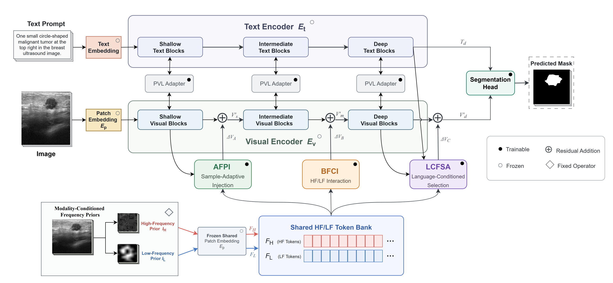
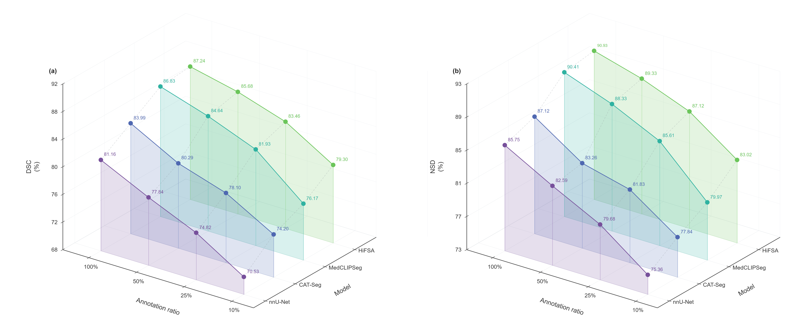
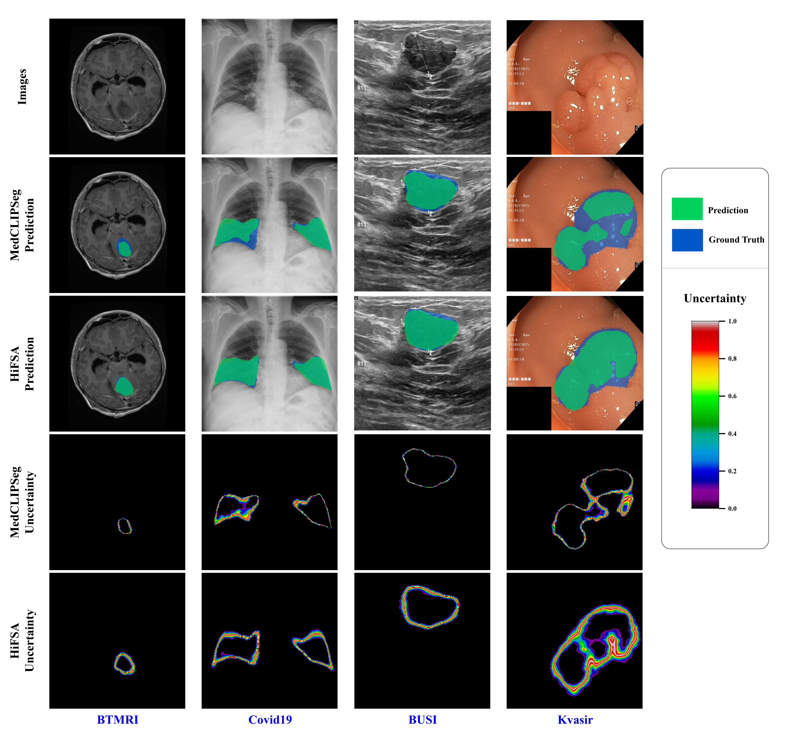

# HiFSA: Hierarchical Frequency-Semantic Adaptation for Data-Efficient Medical Vision-Language Segmentation

## Overview

**Abstract.** Medical image segmentation under limited pixel-level annotations remains challenging because medical imaging modalities exhibit distinct frequency characteristics and visual representations require different forms of adaptation across semantic depths. We propose **HiFSA**, a hierarchical frequency-semantic adaptation framework for data-efficient medical vision-language segmentation. HiFSA organizes frequency information through modality-conditioned prior construction, a shared frequency representation, and stage-specific adaptation. Its three complementary modules—AFPI, BFCI, and LCFSA—operate at shallow, intermediate, and deep visual-semantic stages, respectively, while drawing on the same shared frequency-token source. This design enables frequency priors to be reused throughout visual encoding without applying a single fusion strategy uniformly at every stage. We evaluate HiFSA on four public datasets spanning four medical imaging modalities under four annotation ratios. Quantitative comparisons and qualitative analyses show consistent improvements under a unified evaluation protocol, with more pronounced relative gains in low-annotation settings.

## Method

*Figure 1. Overall architecture of HiFSA.*

HiFSA integrates modality-conditioned frequency priors into a vision-language segmentation framework through a shared high-/low-frequency (HF/LF) token bank and hierarchical residual adaptation. Frequency priors are constructed according to modality-specific characteristics and encoded into a shared representation. At progressively deeper visual-semantic stages, AFPI, BFCI, and LCFSA perform complementary adaptation operations—sample-adaptive prior injection, bidirectional high-/low-frequency interaction, and language-conditioned selection—while maintaining stage-specific adaptation pathways. This shared-source, multi-stage design reuses frequency information without imposing the same fusion operation at every stage of visual encoding.

## Results

HiFSA is evaluated on four public datasets spanning four medical imaging modalities and four annotation ratios. The results below present quantitative comparisons and qualitative segmentation outputs, including uncertainty maps.

### Quantitative Comparison

*Figure 2. Comparison of Dice Similarity Coefficient (DSC) and Normalized Surface Dice (NSD) across annotation ratios and comparison methods.*

The quantitative results show that HiFSA performs competitively across annotation settings, with more pronounced relative gains in low-annotation regimes. DSC reflects region-overlap quality, while NSD complements it by evaluating boundary agreement.

### Qualitative Segmentation and Uncertainty

*Figure 3. Qualitative segmentation results and predictive uncertainty maps across the evaluated medical imaging datasets.*

The qualitative results compare segmentation predictions alongside their uncertainty maps. These visualizations provide complementary evidence of segmentation behavior and spatially varying predictive uncertainty across different imaging modalities.

## Installation

For environment setup and dataset organization, please see the [Installation Guide](assets/INSTALL.md).
